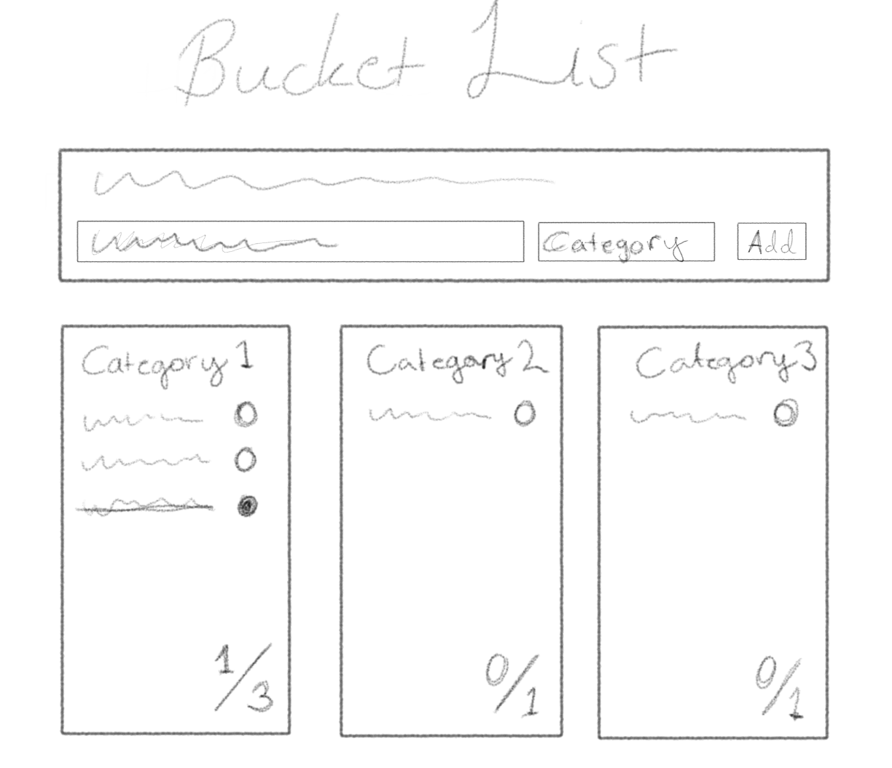
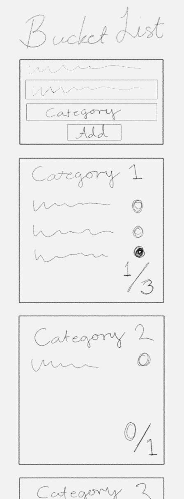
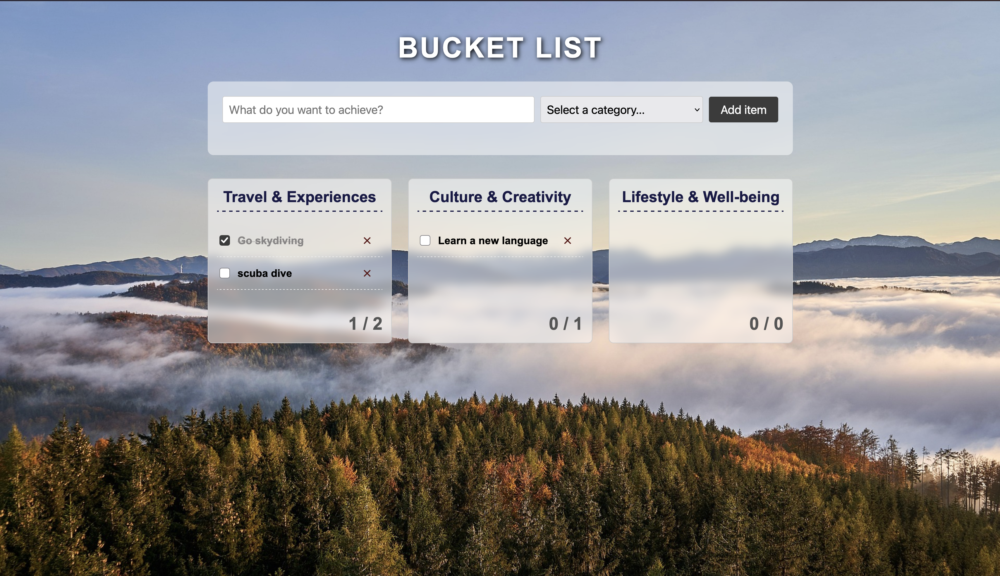
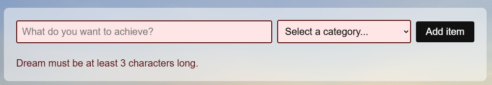
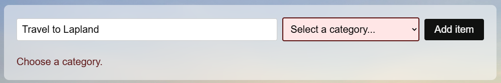

# Bucket list

**Tekijä(t):** Elina ja Ronja

## Projektisuunnitelma

### Projektin idea

Luoda verkkosivusto, jonka ideana on toimia henkilökohtaisena muistilistana asioista, saavutuksista ja kokemuksista, joita henkilö haluaa kokea oman elämän aikana.

### Suunnitellut toiminnot

Listaa vähintään kolme sovellukseesi suunniteltua toimintoa:

- Asian, saavutuksen tai kokemuksen lisääminen listaan ja validointi. (error tulee, jos vaatimukset ei täyty)
- Toteutuneen asian, saavutuksent tai kokemuksen merkintä suoritetuksi tai poistaminen
- Toteutuneiden haaveiden/unelmien lukumäärä (laskuri)

### Rautalankamalli / luonnos

Työpöytämalli:

Mobiilimalli:

## Verkkolinkit

- **Julkaistu sovellus:** [Lisää tähän GitHub Pages -osoite](https://yourusername.github.io/your-repository/)
- **GitHub-repositorio:** [Projekti_1_DOM_Skriptaus](https://github.com/ElinaSofia/Projekti_1_DOM_Skriptaus)

## Tietoja sovelluksesta

**[Bucket List]** on verkkosovellus, jonka tarkoitus on antaa käyttäjälle mahdollisuus listata haaveita ja unelmia. 

Käyttäjä voi kirjata haaveen tai unelman tekstikenttään, valita sille sopivaksi koetun kategorian alasvetovalikosta ja lisätä unelman kategorian mukaiseen korttiin. 

Valmiiksi määriteltyihin kategorioihin sisältyy:
Travel & Experiences, Culture & Creativity, Lifestyle & Well-being

Kun haave/unelma on kirjattu korttiin, voi käyttäjä klikata sen suoritetuksi tai poistaa sen kokonaan. Samalla oikealla alakulmassa oleva laskuri päivittyy.

## Teknologiat

Kuvaile, mitä teknologioita käytit ja mikä niiden rooli oli projektissasi.

- HTML – sivun rakenne
- CSS – ulkoasu ja asettelu
- JavaScript – toiminnallisuus, DOM-skriptaus ja lomakkeiden validointi
- localStorage – tietojen tallentaminen selaimeen

## Sovelluksen käyttö

Instructions:
1. Open the webpage -> 
2. Fill in what you want to achieve and select a relevant category.
3. Click the "Add item"-button. (The dream will be placed according to the category you selected)
4. When you have completed a dream, click the checkbox on the right. (Counter will update accordingly)
5. If you want to delete a dream, click the "x" (delete-button). 
6. All dreams will be saved to your Local Storage, so even if you leave the site, it will remember what was there. 

## Sovelluksen käynnistäminen paikallisesti

1. Kloonaa tai lataa tämä repositorio omalle koneellesi.
2. Avaa projektikansio.
3. Avaa `index.html` selaimessa.

## Kuvakaappaukset

Toimiva verkkosivu:

Teksti alle 3 merkkiä - error:

Teksti alle 3 merkkiä - error:

## Tunnetut virheet / puutteet

**Ei tunnettuja virheitä.**

## Työn jakautuminen

Projekti toteuttiin suhteellisen tiiviillä aikataululla, mutta siitä huolimatta yhteistyö sujui hienosti. Toteutus jakautui tasapuolisesti, sillä kaikki vaiheet tehtiin yhteistyöllä. Tämä hoitui helposti Discordin avulla. Ainoa haaste, joka projektin alkuvaiheessa ilmeni oli saada Live Share toimimaan, mutta sekin lopulta onnistui ja homma jatkui. 

- Tekijä 1: Elina Miasnikova
- Tekijä 2: Ronja Huotari

## Oma arvio ja oppimisen reflektointi

- Missä onnistuin? Meidän mielestä toteutunut verkkosivu on kaikinpuolin onnistunut omien ja tehtävänannon mukaisten tavoitteiden mukaisesti (-video).

- Mikä oli haastavaa? Live sharen käyttöönotto.

- Mitä parantaisin, jos aikaa olisi enemmän? Enemmän toiminnallisuuksia, esim. muokkaa haavetta mikä on jo lisätty, eikä poistaa sitä ensin kokonaan ja kirjoittaa se uudestaan. Toteutunut haave siirtyisi automaattisesti listan alapuolelle. Laskuri kaikille haaveille.

- Mitä opin HTML:stä, CSS:stä, JavaScriptistä ja DOM-skriptauksesta? Ainakin id-atribuuttien käytöstä ja niiden merkityksestä JavaScriptiä toteuttaessa. Opittiin käyttämään if-lausekkeita esimerkiksi erroreiden ja toteutuneiden haaveiden kanssa. 

- Mikä jäi epäselväksi tai mistä haluaisin oppia lisää? Yleisesti haluamme päästä syventämään osaamista kaikesta kurssilla käsiteltävästä asiasta.

- Oma arvio projektista: **xx/10 pistettä**

## Lähteet ja kiitokset

- Kurssimateriaali
- [W3Schools](https://www.w3schools.com/)
- [MDN Web Docs](https://developer.mozilla.org/en-US/)

- Kuvat:
  - Taustakuva - Vapaasti käytettävä kuva Pixabayn kuvapankista
  - Wireframet - Itse piirretty Krita sovelluksella ja piirtopöydällä
  - Kuvakaappaukset omasta tekeleestä.

- Käytetty tekoälytyökalu: Copilot
  - Miten työkalua käytettiin: VS Coden sisällä käytetty kirjaamisen nopeuttamiseksi, kun ehdotus vastannut sitä mitä aiottu kirjata.
- Käytetty tekoälytyökalu: Gemini
  - Ideoiminen.
- Käytetty tekoälytyökalu: Claude
  - Koodin eheyden varmistaminen.

  ## Lisenssi

Tämä projekti on lisensoitu MIT-lisenssillä.

Lisätietoa lisenssin lisäämisestä GitHub-projektiin:
https://docs.github.com/en/communities/setting-up-your-project-for-healthy-contributions/adding-a-license-to-a-repository